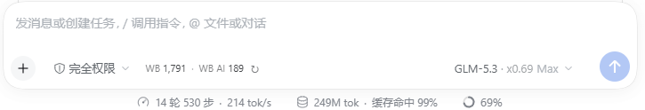

# WorkBuddy Connect

**把 WorkBuddy / WorkBuddy AI 桌面版的模型接进 DeepSeek Harness（DSH）。**
一套本地桥接 + 一个可安装的 DSH 插件：模型选择器里出现 WorkBuddy 分组，
输入框左侧显示**剩余积分**，模型名后跟着**倍率**，**上下文窗口默认取最大值**。

> 其它 harness（Hermes / Claude Code / Codex / OpenClaw）**正在开发中，本版本不做承诺**。

> ⚠️ **不能"只装插件"**：这个 bundle 只是入口，模型列表和令牌由本地桥接按你的账号生成。
> 必须按下面的「快速开始」四步走（WorkBuddy 已登录 → `wbconnect start` → `dsh bundle` → 插件页安装）。
> 跳过任一步都会出现"插件装了但没有模型/没有积分"。


> English TL;DR: A local bridge that exposes WorkBuddy desktop models to **DeepSeek Harness (DSH)**
> as an installable plugin — with live credits in the composer, per-model rate multipliers in the
> model menu, and the largest available context window by default.
> Other harnesses (Hermes, Claude Code, Codex, OpenClaw) are **work in progress** and not part of
> this release.
>
> Highlights: largest context window by default (up to 1M) · live credits & rate multipliers in
> the DSH composer and model menu · reasoning-effort tiers filled in automatically · account-level
> model probing (skips `11158`) · fingerprint workarounds for the CN upstream (`11128`) in one
> place · loopback-only with Bearer auth · `doctor --all` end-to-end self-check.

---

## ✨ 亮点

下面这些是它和"手写一个 provider 配置"真正不一样的地方：

| 亮点 | 说明 |
|---|---|
| **上下文窗口默认拉满** | 国际版模型目录里的 `200K / 300K` 只是**默认值**，实际可选到 `1M`（`supportedContextWindows`，实测 11 个模型受益）。本插件默认取**可选最大值**，例如 `hy4-preview` 从 200K → 1M；也可以按模型精确指定（`contextWindowOverrides`），或退回上游默认（`contextWindowPolicy: "default"`）。 |
| **剩余积分贴在模型名左边** | 输入框工具行最左侧、与模型选择器同一水平线显示 `WB 1,791 · WB AI 189`，悬停看各套餐余量，旁边 `↻` 手动刷新。**仅当当前会话选中 WorkBuddy / WorkBuddy AI 模型时才出现**，换其它模型这一行不占位；但数据仍然在加载时取一次（菜单里 WB 模型行的倍率要用），积分不做轮询。 |
| **模型菜单直接标倍率** | 模型选择器里每一行都显示 `· x0.11 · 夜间折扣`，触发器和菜单当前值同样生效——选模型前就知道这模型贵不贵。 |
| **设置页一张表看全** | 设置 → 插件 → WorkBuddy：账号、登录态、令牌有效期、积分与更新时间、套餐余量、全量模型表（上下文 / 倍率 / 促销）。 |
| **一套桥接，只接 DSH** | 桥接本身同时实现了 OpenAI 与 Anthropic 协议，但目前**只在 DSH 上验证并承诺**；其它 harness 的适配器仍是开发中状态，装了不保证能用。 |
| **推理档位不掉队** | 优先用上游目录声明的 `supportedEfforts`；没声明的模型默认补 `low/medium/high`（`effortPolicy: "declared"` 可关），不会出现"别人能选档位、你不能"。 |
| **账号权限探测** | 同步前用 `max_tokens=1` 逐个探测；上游返回 `11158`（套餐不含）的模型不写入 provider，避免"选中后才 400"。探测失败标为**未验证**，不当成可用。 |
| **国内版指纹兼容** | 上游 `11128` 会按 system prompt 指纹拦截 agent harness。策略统一收敛在桥接一层（`defang` / `neutral` / `pass`），Hermes、Codex、Claude Code、DSH 共用，不用每个 harness 各打一份补丁。 |
| **本地优先** | 只监听 `127.0.0.1`，Bearer 鉴权（同时接受 `x-api-key`），CORS 只对本地来源回发；没有任何第三方服务器中转。 |
| **坏了自己说** | `wbconnect doctor --all` 一次列出桥接/探测/provider/部署/harness 每一环的状态与修复命令；内核契约守卫在导出缺失时给可读错误而不是 `SyntaxError`；同步失败会回滚半写入的 provider；日志超过 5MB 自动轮转。 |

## 🖼️ 界面预览

<p align="center">
  
</p>
<p align="center">
  
  
</p>

## 🧭 工作原理

```
DeepSeek Harness（插件：模型分组 + 积分条 + 菜单倍率）
  └─ OpenAI /v1/chat/completions（pi-ai provider，apiKeyEnv 取自 ~/.dsh/.env）
       └─ bridge（Node，127.0.0.1:39621 国内版 / 39622 国际版）  ← 本地 Bearer 鉴权
            └─ WorkBuddy 桌面登录态（加密凭据，经 App 自带 Electron 解密）
                 └─ copilot.tencent.com / www.workbuddy.ai
```

- **上游认证**：复用 WorkBuddy 桌面 App 的登录态；令牌临近过期自动刷新（跨进程有文件锁）。
- **本地认证**：每个实例一份随机 Bearer 令牌，存在本地数据目录；同时接受
  `Authorization: Bearer` 与 `x-api-key`。
- **协议翻译**：OpenAI 与 Anthropic 双协议、SSE 流式、工具调用、`count_tokens` 都实现了。
- **非流式推理内容**：会把上游 `reasoning_content` 合并进 `message.reasoning_content`
  （有的模型会先耗尽预算推理、正文为空，丢掉推理内容时客户端只看到空回复）。
- **图片输入**：OpenAI 路径原样转发（是否支持看模型）；Anthropic 路径上游没有对应能力，
  图片块替换为文本占位并在响应头标 `x-workbuddy-images: dropped`。

## 🚀 快速开始（DSH）

### 前置条件

| 依赖 | 要求 | 说明 |
|---|---|---|
| **WorkBuddy 桌面版** | 已安装并**登录**（国内版 / 国际版任一或都装） | 桥接复用它的登录态；没装或没登录，后面一定失败 |
| **Python** | 3.10+ | 运行 `wbconnect`（只用标准库，无需 pip 安装） |
| **Node.js** | 18+ | 桥接运行时 |
| **DeepSeek Harness** | 0.2.1-rc.x（已验证 rc.3） | 目标宿主 |

### 四步

```bash
git clone https://github.com/yang9582/workbuddy-connect.git workbuddy-connect
cd workbuddy-connect

# 1) 启动本地桥接（国内版 39621 / 国际版 39622，按需启动）
python -m workbuddy.cli_main start

# 2) 确认登录态与模型数（失败会明确说是"未登录"还是"桥接没起来"）
python -m workbuddy.cli_main status

# 3) 生成 DSH bundle：写入 provider、上下文窗口、推理档位，
#    同时把桥接令牌写进 ~/.dsh/.env（patch 里的 apiKeyEnv 从这里取值）
python -m workbuddy.cli_main dsh bundle
```

4）在 DSH 的「插件」页安装本地包，指向 `dsh/workbuddy-connect/`，然后重启 DSH。

装好后模型选择器里会出现 **WorkBuddy / WorkBuddy AI** 分组；选中其中的模型，输入框左侧会出现积分条。

> 🔌 **桥接会自动启动**：打开 DSH 后 1.5 秒，插件会检查桥接；没在跑就自动执行
> `bin/wbconnect start`（日志写到数据目录的 `autostart.log`，状态里也能看到 `bridgeAutostart`）。
> 想关掉：设环境变量 `WORKBUDDY_NO_AUTOSTART=1`。
>
> 如果你连 DSH 也不想一直开着、但希望开机后桥接就在跑，可以再加一层登录自启
> （Windows「启动」文件夹里的静默脚本，随时可删）：
>
> ```bash
> wbconnect autostart install     # 或 python -m workbuddy.cli_main autostart install
> wbconnect autostart status      # 看装没装、装在哪
> wbconnect autostart uninstall   # 取消
> ```
>
> 排查时 `wbconnect status` 第一行就写着桥接是否在跑。

不确定哪一步没通，先跑自检：

```bash
python -m workbuddy.cli_main doctor --all
```

> 下文用 `wbconnect` 简写 `python -m workbuddy.cli_main`（需在仓库根目录执行）。
> 也可以把 `bin/` 加进 `PATH`，直接用 `wbconnect status`（Windows 用 `bin\wbconnect.cmd`）。

## 🧩 DeepSeek Harness

DSH 的接入不是"改配置文件"那么简单，我们做成了一个**可安装的 bundle**，装完会出现在
DSH 的「插件」页，可启用/停用/卸载：

```bash
# 生成/刷新 bundle 包（会按当前账号的模型目录写 provider、窗口、档位）
python -m workbuddy.cli_main dsh bundle
```

然后在 DSH 的「插件」页安装本地包（指向 `dsh/workbuddy-connect/`）。

> **必须先跑 `dsh bundle` 再安装**：仓库里只有模板 `cordis.patch.example.yml`，
> 真正被 DSH 读取的 `cordis.patch.yml` 是按**你自己的账号**生成的（含模型清单），
> 已被 `.gitignore` 排除，不会出现在仓库里。
>
> 如果你先装了插件却没生成 patch，插件自身会在卡片与设置页提示
> "检测不到 WorkBuddy provider"——补跑一次 `dsh bundle`，再在插件页重装或重启 DSH 即可。

它会带来：

1. **模型分组**：模型选择器里出现 `WorkBuddy` / `WorkBuddy AI`，走本地桥接；
2. **积分条**：选中 WorkBuddy 模型时，输入框工具行左侧、模型名左边显示剩余积分（悬停看套餐，`↻` 刷新）；切换成其它模型后自动隐藏；
3. **模型菜单倍率**：每行模型后面追加 `· x0.11 · 夜间折扣`；
4. **设置页**：设置 → 插件 → WorkBuddy，账号/令牌/积分/套餐/全量模型表；
5. **上下文窗口**：默认取该模型可选的最大窗口（国际版最高 1M），设置页能看到生效值与可选项；
6. **推理档位**：目录声明优先，未声明的模型默认补齐三档。

策略都在桥接配置里（`%LOCALAPPDATA%\hermes-workbuddy-bridge\config.json` /
`config.ai.json`），改完重新 `dsh bundle` 并重启 DSH：

| 键 | 作用 |
|---|---|
| `contextWindowPolicy` | `max`（默认，取可选最大窗口）/ `default`（上游当前窗口） |
| `contextWindowOverrides` | `{"hy4-preview": 500000}`，单模型指定窗口 |
| `effortPolicy` | `force`（默认，未声明档位也写三档）/ `declared`（只写有依据的） |
| `effortForceLevels` | 强制写出时使用的档位，默认 `["low","medium","high"]` |
| `effortOverrides` | `{"glm-5.3": ["low","high","max"]}`，单模型指定档位 |

> 为什么没有"模型卡片里选窗口"的下拉？DSH 的 `llm-pi-ai` 配置每个模型只能声明一个
> `contextWindow`。要做成下拉需要像官方插件那样在 Host 代码里程序化注册 provider，
> 代价是重新引入与 DSH 内核的版本耦合——本项目刻意选择了"配置化 + 设置页可见"。
>
> 另外：上游目录只有**国际版**给可选窗口（`supportedContextWindows`），国内版只有一个固定窗口。

### 安装前/后自查

```bash
# 离线校验（不启动 DSH）：组合 profile 并打印结果
"<DSH 安装目录>/resources/runtime/cli/bin/dsh.cmd" --profile web --dump-config

# 运行中的 Host 半是否就绪
curl http://127.0.0.1:<DSH端口>/workbuddy/status
```

## 🔌 其它 harness（开发中）

**当前只承诺 DSH。** 桥接本身同时实现了 OpenAI 与 Anthropic 两套协议，代码里也有
Hermes / Claude Code / Codex / OpenClaw 的适配器，但它们**尚未在公开发布的标准上验证**，
不作为本版本的支持范围：

| Harness | 代码状态 | 发布状态 |
|---|---|---|
| **DeepSeek Harness** | bundle + Host/Client 半 | ✅ 支持 |
| Hermes Agent | 适配器与桌面 UI 已有 | 🚧 开发中，未验证 |
| Claude Code | 适配器 + `/v1/messages` | 🚧 开发中，未验证 |
| Codex CLI | 适配器 | 🚧 开发中，未验证 |
| OpenClaw | 适配器（半自动） | 🚧 开发中，未验证 |
| 豆包 / 其它 OpenAI 兼容端 | `wbconnect endpoint` 输出端点 | 🧪 可自行尝试，不保证 |

想接别的 harness，可以先用通用端点自己试：

```bash
python -m workbuddy.cli_main endpoint --show-token   # 输出 base_url / key / 模型列表
```

但请把 issue 里的问题限定在 DSH 范围内，否则很难复现。

## 🛠️ CLI

```bash
python -m workbuddy.cli_main <command>
```

| 命令 | 作用 |
|---|---|
| `status` | 桥接状态 + 登录态 + 模型数 |
| `start` / `stop` / `restart` | 启停桥接实例 |
| `models [--instance]` | 列出模型 |
| `probe --effort [--reprobe]` | 探测哪些模型真正校验 `reasoning_effort`（结果供 DSH 生成使用） |
| `endpoint [--show-token]` | 打印 OpenAI 兼容端点（令牌默认打码） |
| `dsh [status\|bundle\|restore]` | **DSH 接入状态 / 生成 bundle / 恢复旧补丁** |
| `autostart [status\|install\|uninstall]` | 开机自启（Windows 启动文件夹里的静默脚本） |
| `doctor` / `doctor --all [--json]` | 桥接自检 / 端到端检查 |
| `kernel [--refresh]` | 桥接内核来源与哈希；升级内核后重新提取并校验导出 |
| `logs` | 查看桥接日志 |
| `install --harness …` / `uninstall --harness …` | 其它 harness 的安装器（开发中） |
| `sync [--profiles all]` | 刷新 Hermes provider（开发中） |

## ⚙️ 配置

### 桥接配置（数据目录）

`%LOCALAPPDATA%\hermes-workbuddy-bridge\config.json` / `config.ai.json`：

- `port` / `variant` / `token` / `catalogRefreshMinutes` / `creditsCacheSeconds`
- `systemPolicy`：`pass` / `defang` / `neutral`（不写则按协议面取默认：OpenAI 国内版 `defang`、
  国际版 `pass`；Anthropic 面 `neutral`）
- `systemBlockedPhrase` / `systemSafePhrase` / `neutralSystemPrompt` / `neutralMinLength`
- `anthropicSystemMode`（旧键，仍优先）、`anthropicDefaultModel`、`modelAliases`
- DSH 生成策略：`contextWindowPolicy`、`contextWindowOverrides`、`effortPolicy`、
  `effortForceLevels`、`effortOverrides`

端口优先级：`WORKBUDDY_BRIDGE_PORT` 环境变量 > 配置文件 > 默认 `39621`。

### 安全与日志

- **CORS 只放行本地来源**：`file://`、`app://`、`null`（Electron 渲染进程）与 localhost/127.0.0.1；
  其他网页拿不到 `Access-Control-Allow-Origin`。
- **调试转储默认关闭**：完整 Anthropic 请求体（含 system prompt 与工具）只在
  `WORKBUDDY_BRIDGE_DUMP=1` 时写入 `state/`；`WORKBUDDY_BRIDGE_DEBUG=1` 只影响日志详细度。
- **日志轮转**：每次启动前，超过 5MB 的日志挪到 `<name>.1`。
- **探测限流**：并发 2，429 退避 1.5s 重试一次；仍失败记为"未验证"。

## 🩺 自检

```bash
python -m workbuddy.cli_main doctor --all          # 表格，失败时退出码 1
python -m workbuddy.cli_main doctor --all --json   # 给脚本用
```

覆盖：桥接监听 / healthz / 登录态 / 本地令牌 / 内核哈希 / system 策略 / 模型探测
（可用·无权限·未验证）/ DSH（bundle、patch 是否存在、旧补丁残留）/ 部署版本漂移 / node 与桌面插件。
开发中的 harness（Hermes / Claude Code / Codex / OpenClaw）也会顺带检查，但不在支持范围内。

## 🔧 故障排查

| 现象 | 处理 |
|---|---|
| `11128 request illegal / unapproved channel` | system prompt 命中上游指纹：确认内核是 0.7.9+，把 `systemPolicy` 设为 `defang`（国内版默认）；`wbconnect restart` |
| `11158 not allowed for user type` | 该模型不在账号套餐内；`wbconnect install --harness dsh` 会重新探测并剔除（bundle 用 `dsh bundle` 重生成） |
| `WorkBuddy 内核契约不匹配` | `wbconnect kernel` 看记录，`wbconnect kernel --refresh` 重新提取并校验导出 |
| `502 transport error: fetch failed` | 本机到 `www.workbuddy.ai` 不通（代理/DNS），与插件无关；恢复后 `wbconnect restart` |
| DSH 里没有 WorkBuddy 分组 | 重启 DSH；`wbconnect dsh status` 看 `mode`；`~/.dsh/.env` 要有 `WORKBUDDY_BRIDGE_TOKEN` |
| DSH 输入框左侧没有积分条 | `curl http://127.0.0.1:<端口>/workbuddy/status` 确认 Host 半；`/workbuddy/beacon` 看 Client 半自检；必要时刷新页面、disable→enable 插件或重启 DSH |
| 模型菜单里没有倍率 | 该标签由 Client 半接管，需要刷新页面或重启 DSH 加载新模块 |
| 没有推理档位 | 默认会补齐三档；检查 `effortPolicy` 是否被设为 `declared`，或模型是否有 `reasoning` 字段 |
| 不确定哪一环坏了 | `wbconnect doctor --all` |

## 🧪 开发与测试

```bash
python -m compileall -q workbuddy __init__.py
python -m unittest discover -s tests -t . -v          # Python：78 项
node --test bridge/test/*.test.mjs                    # 桥接：31 项（策略/内核/CORS/SSE 拼装/模型字段）
node --test dsh/workbuddy-connect/test/*.test.mjs     # bundle：15 项（Host 路由/裁剪/自检 + Client 注册）
python -m workbuddy.cli_main doctor --all
```

仓库结构（简版）：

```
workbuddy/            Python 核心：进程管理、CLI、DSH 适配器（其余 harness 适配器为开发中）
bridge/               Node 桥接：OpenAI + Anthropic 双协议、目录/积分/策略
dsh/workbuddy-connect DSH bundle：声明式 patch + Host 半 + Client 半
vendor/               第三方内核与离线包（见 THIRD_PARTY_NOTICES.txt）
tests/                单元测试（标准库 unittest，无第三方依赖）
```

## 🆚 和直接用 dsh-workbuddy-connect 的区别

[dsh-workbuddy-connect](https://github.com/corrinehu/dsh-workbuddy-connect) 是一个优秀的 DSH 插件，
功能比本项目更全（模型显隐、企业额度、图片输入等）。两者的定位不同：

| | dsh-workbuddy-connect | 本项目 |
|---|---|---|
| 目标 harness | 只有 DSH | DSH（其它开发中，不承诺） |
| DSH 接入方式 | 插件（peerDependencies 精确绑定内核版本） | 声明式 bundle（只依赖 `llm-pi-ai` 配置），可随时 `dsh bundle` 重生成 |
| 升级 DSH 内核 | 需要匹配的插件版本 | 只有桥接内核需要跟（`kernel --refresh` + 契约守卫） |
| 积分/倍率展示 | DSH 内卡片 | 输入框左侧积分条 + 菜单行倍率 + 设置页全量表 |
| 上下文窗口 | 国际版提供开关 | 默认取最大，可按模型覆盖（`contextWindowOverrides`） |
| 排障 | 插件自带 doctor | `doctor --all` 覆盖桥接 → provider → bundle 整条链路 |

如果你只用 DSH、且想要最全的插件内功能（模型显隐、企业额度、图片输入），直接用上游插件更省事；
如果你更在意"DSH 升级后不用等插件适配"、以及想把倍率和积分直接摆在输入框旁边，可以试本项目。

## ⚠️ 限制与免责声明

- **非官方项目**：与 WorkBuddy / 腾讯 / DeepSeek 均无关联，未获其背书。
- **依赖非公开接口**：桥接复用 WorkBuddy 桌面客户端的登录态与私有 API，**客户端大版本更新后
  可能失效**，届时需要更新 `bridge/vendor/host-bundle.js`（`wbconnect kernel --refresh`）。
- **图片输入不完整**：OpenAI 路径原样转发（看模型是否支持）；Anthropic 路径会把图片替换成
  文本占位并在响应头标 `x-workbuddy-images: dropped`。
- **只支持 DSH**：其它 harness 的适配器还在开发中，接口可能变，不保证可用。
- **只测过 Windows**：路径与进程管理在 Windows 上验证；macOS / Linux 未验证。
- **桥接需要常驻**：打开 DSH 时会自动尝试拉起（`WORKBUDDY_NO_AUTOSTART=1` 可关）；
  如果自动拉起失败（例如 `python` 不在 PATH），模型仍会列在选择器里但调用失败，
  积分条显示 `✕`，此时手动 `wbconnect start` 即可。
- **DSH 里没有"模型显隐/窗口下拉"**：这两项依赖 DSH 插件把 provider 程序化注册，本项目为了
  避开版本耦合只做配置化 + 设置页展示。
- **个人使用定位**：请自行确认符合 WorkBuddy 的服务条款与所在地区法规；不要用于商业转售、
  账号共享或任何规避计费的行为。本项目不提供、也不存储任何账号凭据。
- **凭据在本机**：本地令牌与 WorkBuddy 登录态保存在你自己的数据目录里（明文文件），
  请勿把这些文件提交到仓库或分享给他人。
- **无担保**：按 MIT 协议「AS IS」提供，使用风险自负。

## 📄 许可与第三方

- 本项目：[MIT](LICENSE)。
- `bridge/vendor/host-bundle.js` 与 `vendor/dsh-workbuddy-connect/` 来自
  [dsh-workbuddy-connect](https://github.com/corrinehu/dsh-workbuddy-connect)（MIT，© Corrine Hu），
  详见 [THIRD_PARTY_NOTICES.txt](THIRD_PARTY_NOTICES.txt)。
- 安全与隐私说明见 [SECURITY.md](SECURITY.md)，参与开发见 [CONTRIBUTING.md](CONTRIBUTING.md)。
