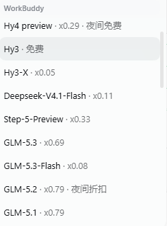
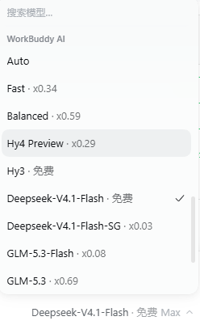

# WorkBuddy Connect

**把 WorkBuddy / WorkBuddy AI 桌面版的模型，一行命令接进你正在用的 agent harness。**
Hermes Agent、Claude Code、Codex CLI、OpenClaw、DeepSeek Harness（DSH）共用一套本地桥接；
在 DSH 里还能直接在界面上看到**剩余积分、模型倍率**，并把**上下文窗口默认拉满**。


> English TL;DR: A local OpenAI/Anthropic-compatible bridge that exposes WorkBuddy desktop models
> to Hermes, Claude Code, Codex, OpenClaw and DeepSeek Harness — with a DSH plugin that shows
> live credits, per-model rate multipliers, and uses the largest context window by default.
>
> Highlights: largest context window by default (up to 1M) · live credits & rate multipliers in
> the DSH composer and model menu · one bridge for five harnesses · reasoning-effort tiers filled
> in automatically · account-level model probing (skips `11158`) · fingerprint workarounds for the
> CN upstream (`11128`) in one place · loopback-only with Bearer auth · `doctor --all` end-to-end
> self-check.

---

## ✨ 亮点

下面这些是它和"手写一个 provider 配置"真正不一样的地方：

| 亮点 | 说明 |
|---|---|
| **上下文窗口默认拉满** | 国际版模型目录里的 `200K / 300K` 只是**默认值**，实际可选到 `1M`（`supportedContextWindows`，实测 11 个模型受益）。本插件默认取**可选最大值**，例如 `hy4-preview` 从 200K → 1M；也可以按模型精确指定（`contextWindowOverrides`），或退回上游默认（`contextWindowPolicy: "default"`）。 |
| **剩余积分贴在模型名左边** | DSH 输入框工具行的最左侧、与模型选择器同一水平线上常驻 `WB 1,791 · WB AI 189`，悬停看各套餐余量，旁边的 `↻` 可手动刷新。积分**不做轮询**（每次查询都会真实打到计费接口），只在挂载与手动刷新时取。 |
| **模型菜单直接标倍率** | 模型选择器里每一行都显示 `· x0.11 · 夜间折扣`，触发器和菜单当前值同样生效——选模型前就知道这模型贵不贵。 |
| **设置页一张表看全** | 设置 → 插件 → WorkBuddy：账号、登录态、令牌有效期、积分与更新时间、套餐余量、全量模型表（上下文 / 倍率 / 促销）。 |
| **一套桥接，五种 harness** | Hermes 原生插件、Claude Code（Anthropic `/v1/messages`）、Codex CLI、OpenClaw、DSH；外加任何支持自定义 OpenAI 兼容端点的产品（豆包等）。 |
| **推理档位不掉队** | 优先用上游目录声明的 `supportedEfforts`；没声明的模型默认补 `low/medium/high`（`effortPolicy: "declared"` 可关），不会出现"别人能选档位、你不能"。 |
| **账号权限探测** | 同步前用 `max_tokens=1` 逐个探测；上游返回 `11158`（套餐不含）的模型不写入 provider，避免"选中后才 400"。探测失败标为**未验证**，不当成可用。 |
| **国内版指纹兼容** | 上游 `11128` 会按 system prompt 指纹拦截 agent harness。策略统一收敛在桥接一层（`defang` / `neutral` / `pass`），Hermes、Codex、Claude Code、DSH 共用，不用每个 harness 各打一份补丁。 |
| **本地优先** | 只监听 `127.0.0.1`，Bearer 鉴权（同时接受 `x-api-key`），CORS 只对本地来源回发；没有任何第三方服务器中转。 |
| **坏了自己说** | `wbconnect doctor --all` 一次列出桥接/探测/provider/部署/harness 每一环的状态与修复命令；内核契约守卫在导出缺失时给可读错误而不是 `SyntaxError`；同步失败会回滚半写入的 provider；日志超过 5MB 自动轮转。 |

## 🖼️ 截图




> 还缺一张"输入框工具行左侧的积分条 + 模型名后倍率"的横图，建议补到
> `docs/screenshots/composer-credits.png`（宽图），这张最能说明亮点。

## 🧭 工作原理

```
harness（Hermes / Claude Code / Codex / OpenClaw / DSH / …）
  └─ OpenAI /v1/chat/completions   或   Anthropic /v1/messages
       └─ bridge（Node，127.0.0.1:39621 国内版 / 39622 国际版）  ← 本地 Bearer 鉴权
            └─ WorkBuddy 桌面登录态（加密凭据，经 App 自带 Electron 解密）
                 └─ copilot.tencent.com / www.workbuddy.ai
```

- **上游认证**：复用 WorkBuddy 桌面 App 的登录态；令牌临近过期自动刷新（跨进程有文件锁）。
- **本地认证**：每个实例一份随机 Bearer 令牌，存在本地数据目录；同时接受
  `Authorization: Bearer` 与 `x-api-key`。
- **协议翻译**：OpenAI 与 Anthropic 双协议、SSE 流式、工具调用、`count_tokens` 都实现了。
- **非流式推理内容**：会把上游 `reasoning_content` 合并进 `message.reasoning_content`
  （有的模型会先耗尽预算推理、正文为空，丢掉推理内容时客户端只看到空回复）。
- **图片输入**：OpenAI 路径原样转发（是否支持看模型）；Anthropic 路径上游没有对应能力，
  图片块替换为文本占位并在响应头标 `x-workbuddy-images: dropped`。

## 🚀 快速开始

需要 **Python 3.10+** 和 **Node.js 18+**（桥接是 Node 写的，插件与 CLI 是 Python）。

```bash
git clone <your-repo-url> workbuddy-connect
cd workbuddy-connect

# 1) 启动本地桥接（国内版 + 国际版各一个实例，按需启动）
python -m workbuddy.cli_main start

# 2) 看状态：登录态 / 模型数 / 账号可用模型
python -m workbuddy.cli_main status

# 3) 装到你检测到的 harness（也可只装某一个）
python -m workbuddy.cli_main install --harness all
python -m workbuddy.cli_main install --harness claude,codex
```

不确定哪一步没通，先跑自检：

```bash
python -m workbuddy.cli_main doctor --all
```

> 下文用 `wbconnect` 简写 `python -m workbuddy.cli_main`（需在仓库根目录执行）。
> 也可以把 `bin/` 加进 `PATH`，直接用 `wbconnect status`（Windows 用 `bin\wbconnect.cmd`）。

## 🧩 DeepSeek Harness（重点）

DSH 的接入不是"改配置文件"那么简单，我们做成了一个**可安装的 bundle**，装完会出现在
DSH 的「插件」页，可启用/停用/卸载：

```bash
# 生成/刷新 bundle 包（会按当前账号的模型目录写 provider、窗口、档位）
python -m workbuddy.cli_main dsh bundle
```

然后在 DSH 的「插件」页安装本地包（指向 `dsh/workbuddy-connect/`）。

> **必须先跑 `dsh bundle` 再安装**：仓库里只有模板 `cordis.patch.example.yml`，
> 真正被 DSH 读取的 `cordis.patch.yml` 是按**你自己的账号**生成的（含模型清单），
> 已被 `.gitignore` 排除，不会出现在仓库里。
>
> 如果你先装了插件却没生成 patch，插件自身会在卡片与设置页提示
> "检测不到 WorkBuddy provider"——补跑一次 `dsh bundle`，再在插件页重装或重启 DSH 即可。

它会带来：

1. **模型分组**：模型选择器里出现 `WorkBuddy` / `WorkBuddy AI`，走本地桥接；
2. **积分条**：输入框工具行左侧、模型名左边常驻剩余积分（悬停看套餐，`↻` 刷新）；
3. **模型菜单倍率**：每行模型后面追加 `· x0.11 · 夜间折扣`；
4. **设置页**：设置 → 插件 → WorkBuddy，账号/令牌/积分/套餐/全量模型表；
5. **上下文窗口**：默认取该模型可选的最大窗口（国际版最高 1M），设置页能看到生效值与可选项；
6. **推理档位**：目录声明优先，未声明的模型默认补齐三档。

策略都在桥接配置里（`%LOCALAPPDATA%\hermes-workbuddy-bridge\config.json` /
`config.ai.json`），改完重新 `dsh bundle` 并重启 DSH：

| 键 | 作用 |
|---|---|
| `contextWindowPolicy` | `max`（默认，取可选最大窗口）/ `default`（上游当前窗口） |
| `contextWindowOverrides` | `{"hy4-preview": 500000}`，单模型指定窗口 |
| `effortPolicy` | `force`（默认，未声明档位也写三档）/ `declared`（只写有依据的） |
| `effortForceLevels` | 强制写出时使用的档位，默认 `["low","medium","high"]` |
| `effortOverrides` | `{"glm-5.3": ["low","high","max"]}`，单模型指定档位 |

> 为什么没有"模型卡片里选窗口"的下拉？DSH 的 `llm-pi-ai` 配置每个模型只能声明一个
> `contextWindow`。要做成下拉需要像官方插件那样在 Host 代码里程序化注册 provider，
> 代价是重新引入与 DSH 内核的版本耦合——本项目刻意选择了"配置化 + 设置页可见"。
>
> 另外：上游目录只有**国际版**给可选窗口（`supportedContextWindows`），国内版只有一个固定窗口。

### 安装前/后自查

```bash
# 离线校验（不启动 DSH）：组合 profile 并打印结果
"<DSH 安装目录>/resources/runtime/cli/bin/dsh.cmd" --profile web --dump-config

# 运行中的 Host 半是否就绪
curl http://127.0.0.1:<DSH端口>/workbuddy/status
```

## 🔌 其它 harness

| Harness | 接入方式 | 状态 |
|---|---|---|
| **Hermes Agent** | 原生插件：3 个工具 + `on_session_start` + `/workbuddy` + 桌面 UI | ✅ 已验证 |
| **Claude Code** | 写入 `~/.claude/settings.json` 的 `ANTHROPIC_*`，桥接提供 `/v1/messages` | ✅ 已验证（含工具调用） |
| **Codex CLI** | 写入 `~/.codex/config.toml` 的 `model_providers.workbuddy` + `profiles.workbuddy` | ✅ 配置已验证 |
| **OpenClaw** | 写出端点 JSON，需在其设置里手动添加 OpenAI 兼容 provider | ⚠️ 半自动 |
| **DeepSeek Harness** | 可安装 bundle（见上）| ✅ 已验证 |
| **豆包 / 其它** | `wbconnect endpoint` 输出 base_url / key / 模型列表，手填 | ⚠️ 通用方案 |

细节：

- **Hermes**：插件装到 `$HERMES_HOME/plugins/workbuddy/`（含 `--profiles all` 的所有 bot profile），
  桌面 UI 由 `desktop/plugin.js` 提供（状态栏积分、模型菜单倍率、输入框 pill、设置页）。
- **Claude Code**：`ANTHROPIC_BASE_URL` 不要带 `/v1`；`claude-*` 模型名会映射到真实 WorkBuddy 模型；
  原设置备份为 `settings.json.workbuddy-backup`。
- **Codex**：`codex --profile workbuddy`；原配置备份为 `config.toml.workbuddy-backup`。
- **OpenClaw**：端点写到 `~/.openclaw/workbuddy-connect.json`，需手动添加 provider。

## 🛠️ CLI

```bash
python -m workbuddy.cli_main <command>
```

| 命令 | 作用 |
|---|---|
| `status` | 桥接状态 + 各 harness 配置状态 |
| `start` / `stop` / `restart` | 启停桥接实例 |
| `models [--instance]` | 列出模型 |
| `probe --effort [--reprobe]` | 探测哪些模型真正校验 `reasoning_effort`（结果供 DSH 生成使用） |
| `endpoint [--show-token]` | 打印 OpenAI 兼容端点（令牌默认打码） |
| `sync [--profiles all] [--reprobe] [--no-probe]` | 刷新 Hermes provider |
| `install --harness …` / `uninstall --harness …` | 安装/移除各 harness 配置 |
| `harnesses` | 列出支持的 harness 与检测结果 |
| `dsh [status\|bundle\|restore]` | DSH 接入状态 / 生成 bundle / 恢复旧补丁 |
| `kernel [--refresh]` | 桥接内核来源与哈希；升级内核后重新提取并校验导出 |
| `doctor` / `doctor --all [--json]` | 桥接自检 / 端到端检查 |
| `logs` | 查看桥接日志 |

Hermes 内另有 `/workbuddy status|start|stop|sync|logs` 斜杠命令。

## ⚙️ 配置

### Hermes 插件设置
`plugins.entries.workbuddy.settings.*`：`autostart`、`auto_sync`、`enable_cn`、`enable_ai`、
`port_cn`、`port_ai`、`data_dir`、`node_path`、`electron_bin_cn`、`electron_bin_ai`、
`probe_models`、`sync_profiles`。

### 桥接配置（数据目录）

`%LOCALAPPDATA%\hermes-workbuddy-bridge\config.json` / `config.ai.json`：

- `port` / `variant` / `token` / `catalogRefreshMinutes` / `creditsCacheSeconds`
- `systemPolicy`：`pass` / `defang` / `neutral`（不写则按协议面取默认：OpenAI 国内版 `defang`、
  国际版 `pass`；Anthropic 面 `neutral`）
- `systemBlockedPhrase` / `systemSafePhrase` / `neutralSystemPrompt` / `neutralMinLength`
- `anthropicSystemMode`（旧键，仍优先）、`anthropicDefaultModel`、`modelAliases`
- DSH 生成策略：`contextWindowPolicy`、`contextWindowOverrides`、`effortPolicy`、
  `effortForceLevels`、`effortOverrides`

端口优先级：`WORKBUDDY_BRIDGE_PORT` 环境变量 > 配置文件 > 默认 `39621`。

### 安全与日志

- **CORS 只放行本地来源**：`file://`、`app://`、`null`（Electron 渲染进程）与 localhost/127.0.0.1；
  其他网页拿不到 `Access-Control-Allow-Origin`。
- **调试转储默认关闭**：完整 Anthropic 请求体（含 system prompt 与工具）只在
  `WORKBUDDY_BRIDGE_DUMP=1` 时写入 `state/`；`WORKBUDDY_BRIDGE_DEBUG=1` 只影响日志详细度。
- **日志轮转**：每次启动前，超过 5MB 的日志挪到 `<name>.1`。
- **探测限流**：并发 2，429 退避 1.5s 重试一次；仍失败记为"未验证"。

## 🩺 自检

```bash
python -m workbuddy.cli_main doctor --all          # 表格，失败时退出码 1
python -m workbuddy.cli_main doctor --all --json   # 给脚本用
```

覆盖：桥接监听 / healthz / 登录态 / 本地令牌 / 内核哈希 / system 策略 / 模型探测
（可用·无权限·未验证）/ 每个 Hermes profile 的 provider 与 `.env` 令牌 /
Claude Code / Codex / OpenClaw / DSH（bundle、旧补丁残留）/ 部署版本漂移 / node 与桌面插件。

## 🔧 故障排查

| 现象 | 处理 |
|---|---|
| `11128 request illegal / unapproved channel` | system prompt 命中上游指纹：确认内核是 0.7.9+，把 `systemPolicy` 设为 `defang`（国内版默认）或让 Claude Code 用默认 `neutral`；`wbconnect restart` |
| `11158 not allowed for user type` | 该模型不在账号套餐内；`wbconnect sync --reprobe` 会剔除 |
| `WorkBuddy 内核契约不匹配` | `wbconnect kernel` 看记录，`wbconnect kernel --refresh` 重新提取并校验导出 |
| `502 transport error: fetch failed` | 本机到 `www.workbuddy.ai` 不通（代理/DNS），与插件无关；恢复后 `wbconnect restart` |
| DSH 里没有 WorkBuddy 分组 | 重启 DSH；`wbconnect dsh status` 看 `mode`；`~/.dsh/.env` 要有 `WORKBUDDY_BRIDGE_TOKEN` |
| DSH 输入框左侧没有积分条 | `curl http://127.0.0.1:<端口>/workbuddy/status` 确认 Host 半；`/workbuddy/beacon` 看 Client 半自检；必要时刷新页面、disable→enable 插件或重启 DSH |
| 模型菜单里没有倍率 | 该标签由 Client 半接管，需要刷新页面或重启 DSH 加载新模块 |
| 没有推理档位 | 默认会补齐三档；检查 `effortPolicy` 是否被设为 `declared`，或模型是否有 `reasoning` 字段 |
| 不确定哪一环坏了 | `wbconnect doctor --all` |

## 🧪 开发与测试

```bash
python -m compileall -q workbuddy __init__.py
python -m unittest discover -s tests -t . -v          # Python：69 项
node --test bridge/test/*.test.mjs                    # 桥接：31 项（策略/内核/CORS/SSE 拼装/模型字段）
node --test dsh/workbuddy-connect/test/*.test.mjs     # bundle：10 项（Host 裁剪/自检 + Client 注册）
python -m workbuddy.cli_main doctor --all
```

仓库结构（简版）：

```
workbuddy/            Python 核心：进程管理、provider 同步、CLI、各 harness 适配器
bridge/               Node 桥接：OpenAI + Anthropic 双协议、目录/积分/策略
dsh/workbuddy-connect DSH bundle：声明式 patch + Host 半 + Client 半
desktop/plugin.js     Hermes 桌面 UI
vendor/               第三方内核与离线包（见 THIRD_PARTY_NOTICES.txt）
tests/                单元测试（标准库 unittest，无第三方依赖）
```

## 🆚 和直接用 dsh-workbuddy-connect 的区别

[dsh-workbuddy-connect](https://github.com/corrinehu/dsh-workbuddy-connect) 是一个优秀的 DSH 插件，
功能比本项目更全（模型显隐、企业额度、图片输入等）。两者的定位不同：

| | dsh-workbuddy-connect | 本项目 |
|---|---|---|
| 目标 harness | 只有 DSH | Hermes / Claude Code / Codex / OpenClaw / DSH |
| DSH 接入方式 | 插件（peerDependencies 精确绑定内核版本） | 声明式 bundle（只依赖 `llm-pi-ai` 配置），可随时 `dsh bundle` 重生成 |
| 升级 DSH 内核 | 需要匹配的插件版本 | 只有桥接内核需要跟（`kernel --refresh` + 契约守卫） |
| 积分/倍率展示 | DSH 内卡片 | DSH 卡片 + 菜单倍率 + Hermes 桌面 UI |
| 上下文窗口 | 国际版提供开关 | 默认取最大，可按模型覆盖（`contextWindowOverrides`） |
| 排障 | 插件自带 doctor | `doctor --all` 覆盖桥接 → provider → 各 harness 整条链路 |

如果你只用 DSH、且想要最全的插件内功能，直接用上游插件更省事；如果你要跨 harness 复用、
或者希望"DSH 升级不用等插件适配"，本项目更合适。

## ⚠️ 限制与免责声明

- **非官方项目**：与 WorkBuddy / 腾讯 / DeepSeek 均无关联，未获其背书。
- **依赖非公开接口**：桥接复用 WorkBuddy 桌面客户端的登录态与私有 API，**客户端大版本更新后
  可能失效**，届时需要更新 `bridge/vendor/host-bundle.js`（`wbconnect kernel --refresh`）。
- **图片输入不完整**：OpenAI 路径原样转发（看模型是否支持）；Anthropic 路径会把图片替换成
  文本占位，Claude Code 粘贴截图不会真的送图。
- **DSH 里没有"模型显隐/窗口下拉"**：这两项依赖 DSH 插件把 provider 程序化注册，本项目为了
  避开版本耦合只做配置化 + 设置页展示。
- **个人使用定位**：请自行确认符合 WorkBuddy 的服务条款与所在地区法规；不要用于商业转售、
  账号共享或任何规避计费的行为。本项目不提供、也不存储任何账号凭据。
- **凭据在本机**：本地令牌与 WorkBuddy 登录态保存在你自己的数据目录里（明文文件），
  请勿把这些文件提交到仓库或分享给他人。
- **无担保**：按 MIT 协议「AS IS」提供，使用风险自负。

## 📄 许可与第三方

- 本项目：[MIT](LICENSE)。
- `bridge/vendor/host-bundle.js` 与 `vendor/dsh-workbuddy-connect/` 来自
  [dsh-workbuddy-connect](https://github.com/corrinehu/dsh-workbuddy-connect)（MIT，© Corrine Hu），
  详见 [THIRD_PARTY_NOTICES.txt](THIRD_PARTY_NOTICES.txt)。
- 安全与隐私说明见 [SECURITY.md](SECURITY.md)，参与开发见 [CONTRIBUTING.md](CONTRIBUTING.md)。
